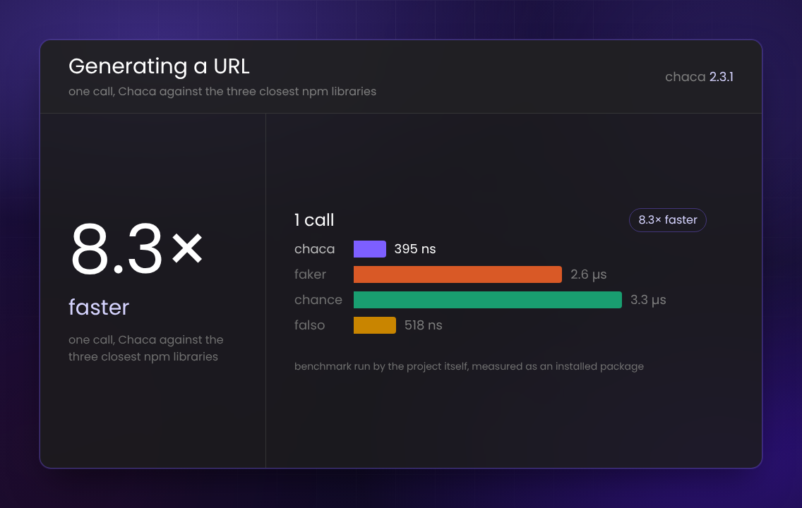

<p align="center"></p>

<h2 align="center">🌚 Think your data and let Chaca create it.</h2>

<p align="center">
  <a href="https://www.npmjs.com/package/chaca"></a>
  <a href="https://www.npmjs.com/package/chaca"></a>
  <a href="https://bundlephobia.com/package/chaca"></a>
  
  
  <a href="https://github.com/hgomezrobaina/chaca/blob/main/LICENSE"></a>
</p>

## 😀 Intro

Welcome to Chaca, a powerful library that revolutionizes mock data generation for testing and development. Define the shape of your data once and let Chaca generate realistic, diverse and **relational** fake data to simulate any scenario for your application.

Chaca is **isomorphic**: the same API runs in **Node.js and in the browser** (React, Vue, Svelte, ...). Your bundler automatically picks the right build, so you can generate data on the server, in a script, in the CLI, or straight in the browser.

## ✨ Features

- 🌐 **Runs everywhere** — Node.js and the browser, ESM and CommonJS, with TypeScript types included.
- 🧩 **Batteries included** — a large set of data `modules` (person, address, internet, finance, image, date, ...) ready to use.
- 🔗 **Relational data** — model references between schemas with `Dataset` and `chaca.ref(...)`.
- 📤 **Multi-format export** — serialize to `json`, `csv`, `yaml`, `postgresql`, `mysql`, `sqlite`, `java`, `python`, `typescript` and `javascript`.
- 🧠 **Dynamic fields** — each field can depend on the other fields of the document or on the dataset state.
- 🕹️ **CLI** included to generate data from a config file.

## 📦 Installation

```shell
npm install chaca
```

Requires Node.js >= 18 (when used on the server). In the browser, just import it — no configuration needed.

## 😎 Usage

### Define a schema and generate data

```ts
import { chaca, modules } from "chaca";

const movieSchema = chaca.schema({
  id: chaca.key(() => modules.id.uuid()),
  authors: {
    type: () => modules.person.fullName(),
    isArray: { min: 1, max: 3 },
  },
  image: () => modules.image.film(),
  likes: () => modules.datatype.int({ min: 0, max: 500000 }),
  category: chaca.enum(["Horror", "War", "History", "Comedy"]),
  adultMovie: ({ currentFields: docFields }) => {
    return docFields.category === "Horror" || docFields.category === "War";
  },
});

// Generate 20 objects with the defined schema
const docs = await movieSchema.array(20);

/*
[
  {
    id: "4136cd0b-d90b-4af7-b485-5d1ded8db252",
    authors: ["Olivia Jones", "Santiago Walker"],
    image: "https://loremflickr.com/1746/1746/film?lock=13845",
    likes: 21456,
    category: "Horror",
    adultMovie: true,
  },
  ...rest, // 19 more documents
];
*/
```

### Serialize in memory — `transform()` (works in the browser)

`transform` returns the serialized files **in memory** (`{ filename, content }[]`), without touching the filesystem. This is the way to obtain the data in the browser, e.g. to trigger a download.

```ts
const files = await movieSchema.transform(20, {
  filename: "movies",
  format: "json",
});

// files[0].filename -> "movies.json"
// files[0].content  -> "[ { ... }, ... ]"  (string, ready to download or display)
```

### Export to files — `export()` (Node.js only)

`export` writes the generated data to disk.

```ts
await movieSchema.export(20, {
  filename: "movies",
  format: "json",
  location: "./folder",
});
```

> In the browser `export` is not available (there is no filesystem) and throws a descriptive error. Use `transform` instead.

## 🔗 Relational data

Use `Dataset` to generate several related schemas at once, referencing fields across them with `chaca.ref("Schema.field")`.

```ts
import { chaca, modules } from "chaca";

const userSchema = chaca.schema({
  id: chaca.key(() => modules.id.uuid()),
  username: () => modules.internet.username(),
});

const postSchema = chaca.schema({
  id: chaca.key(() => modules.id.uuid()),
  title: () => modules.lorem.words(),
  user: chaca.ref("User.id"), // references a User.id value
});

const dataset = chaca.dataset([
  { name: "User", schema: userSchema, documents: 3 },
  { name: "Post", schema: postSchema, documents: 10 },
]);

const data = await dataset.generate(); // { User: [...], Post: [...] }

// Datasets can be serialized too:
const files = await dataset.transform({ filename: "blog", format: "postgresql" });
```

## 🧩 Data modules

Chaca ships with a batteries-included set of data generators, accessible through `modules`:

```ts
modules.person.fullName();
modules.internet.email();
modules.address.country();
modules.finance.bitcoinAddress();
modules.image.film();
modules.datatype.int({ min: 0, max: 100 });
modules.distribution.normal({ mean: 35, standardDeviation: 8 });
```

See the full list in the [modules documentation](https://chaca.run).

## 🌍 Locales

Chaca ships with English only. To generate values in another language, register its locale first:

```ts
import { modules, Language } from "chaca";
import { es } from "chaca/locale/es";

modules.registerLocale(es);

modules.person.fullName({ language: Language.Spanish }); // "Olivia González Gómez"
modules.word.noun({ language: Language.Spanish }); // "ventana"
```

Each locale is its own `chaca/locale/<code>` entry point, so a bundler only ships the locales a
project actually imports — registering `es` never pulls Spanish data into a bundle that doesn't
import it. `en` is the only locale that's always included.

Asking for a language nobody registered never throws: it falls back silently to `en`.

Not every value depends on `language`. Some data has no translation to begin with — animal breeds,
vehicle manufacturers and models, IANA time zones, country codes, CSS value syntax — and stays the
same regardless of the locales you register.

| Code | Language |
| --- | -------- |
| `en` | English (default) |
| `es` | Spanish |

## 📤 Export formats

Both `transform` and `export` support these `format` values:

`json` · `csv` · `yaml` · `postgresql` · `mysql` · `sqlite` · `java` · `python` · `typescript` · `javascript`

## ⚡ Benchmarks

Measured on 2026-11-04 against `@faker-js/faker`, `chance` and `@ngneat/falso` (chaca 2.3.1) —
speed on 17 single-value operations, catalog uniqueness, and output size. Chaca wins most of them
(up to 8.3x faster generating a URL), and loses some too: every result, including the losses, is
published on the same page.



This is a benchmark run by the Chaca project itself, not an independent one. Full results, the
method and the exact commands to reproduce it are on the
[benchmarks page](https://chaca.run/docs/guides/benchmarks) — these figures are from chaca 2.3.1
and will not stay current forever; the page is where they are kept up to date.

## 📘 Documentation

Visit our website to read the documentation. [Chaca Docs](https://chaca.run)

## 🕹️ CLI

See [CLI guide](https://chaca.run/docs/guides/cli)

## 🌐 Try our REST API

If you don't want to use our npm package you can use our [REST API](https://chaca.run/docs/rest-api/overview) to create your mock data

## 🗂️ Changelog

Detailed changes for each release are documented in the [CHANGELOG.md](https://github.com/hgomezrobaina/chaca/blob/main/CHANGELOG.md).

## Contributing

The Chaca project welcomes all constructive contributions. Contributions take many forms, from code for bug fixes and enhancements, to additions and fixes to documentation, additional tests, triaging incoming pull requests and issues, and more!. [See CONTRIBUTING.md](https://github.com/hgomezrobaina/chaca/blob/main/CONTRIBUTING.md)

## License

MIT
