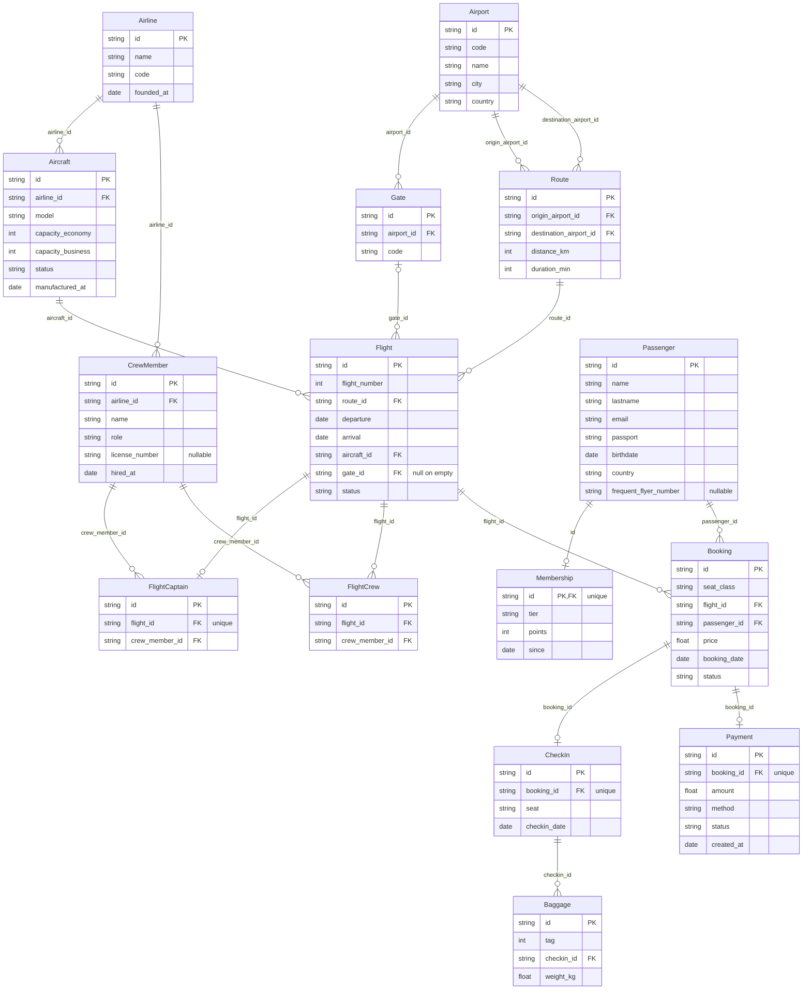

# Airline case — schema

Generated from the schema definitions and the last generated dataset — see `test/example-case/README.md` for how to regenerate it. Do not edit by hand.

## Diagram

## Entities

### Airline

| Field | Type | Null | Key | Origin | Rules |
|---|---|---|---|---|---|
| `id` | string | no | PK | `chaca.key` | — |
| `name` | string | no | — | custom function | — |
| `code` | string | no | — | `chaca.sequential` | R34 |
| `founded_at` | date | no | — | custom function | — |

### Airport

| Field | Type | Null | Key | Origin | Rules |
|---|---|---|---|---|---|
| `id` | string | no | PK | `chaca.key` | — |
| `code` | string | no | — | `chaca.sequential` | R35 |
| `name` | string | no | — | custom function | — |
| `city` | string | no | — | custom function | — |
| `country` | string | no | — | custom function | — |

### Gate

| Field | Type | Null | Key | Origin | Rules |
|---|---|---|---|---|---|
| `id` | string | no | PK | `chaca.key` | — |
| `airport_id` | string | no | FK → Airport.id | `chaca.ref` | R8, R36 |
| `code` | string | no | — | custom function | R36 |

### Aircraft

| Field | Type | Null | Key | Origin | Rules |
|---|---|---|---|---|---|
| `id` | string | no | PK | `chaca.key` | — |
| `airline_id` | string | no | FK → Airline.id | `chaca.ref` | R14, R38 |
| `model` | string | no | — | `chaca.enum` | — |
| `capacity_economy` | int | no | — | custom function | R19 |
| `capacity_business` | int | no | — | custom function | R19 |
| `status` | string | no | — | `chaca.probability` | R6 |
| `manufactured_at` | date | no | — | custom function | — |

### Route

| Field | Type | Null | Key | Origin | Rules |
|---|---|---|---|---|---|
| `id` | string | no | PK | `chaca.key` | — |
| `origin_airport_id` | string | no | FK → Airport.id | `chaca.ref` | R1, R2, R8 |
| `destination_airport_id` | string | no | FK → Airport.id | `chaca.ref` | R1, R2 |
| `distance_km` | int | no | — | custom function | R3, R20 |
| `duration_min` | int | no | — | custom function | R3, R5 |

### Flight

| Field | Type | Null | Key | Origin | Rules |
|---|---|---|---|---|---|
| `id` | string | no | PK | `chaca.key` | — |
| `flight_number` | int | no | — | `chaca.sequence` | R4 |
| `route_id` | string | no | FK → Route.id | `chaca.ref` | R5, R8 |
| `departure` | date | no | — | custom function | R5, R7, R9, R22, R27 |
| `arrival` | date | no | — | custom function | R5, R7 |
| `aircraft_id` | string | no | FK → Aircraft.id | `chaca.ref` | R6, R7, R14, R38 |
| `gate_id` | string | no | FK → Gate.id | `chaca.ref` | R8 |
| `status` | string | no | — | custom function | R9, R23, R37 |

### CrewMember

| Field | Type | Null | Key | Origin | Rules |
|---|---|---|---|---|---|
| `id` | string | no | PK | `chaca.key` | — |
| `airline_id` | string | no | FK → Airline.id | `chaca.ref` | R14, R38 |
| `name` | string | no | — | custom function | — |
| `role` | string | no | — | `chaca.probability` | R10, R13, R38 |
| `license_number` | string | sometimes | — | custom function | R10 |
| `hired_at` | date | no | — | custom function | — |

### FlightCaptain

| Field | Type | Null | Key | Origin | Rules |
|---|---|---|---|---|---|
| `id` | string | no | PK | `chaca.key` | — |
| `flight_id` | string | no | FK → Flight.id | `chaca.ref` | R12, R13, R37, R38 |
| `crew_member_id` | string | no | FK → CrewMember.id | `chaca.ref` | R38 |

### FlightCrew

| Field | Type | Null | Key | Origin | Rules |
|---|---|---|---|---|---|
| `id` | string | no | PK | `chaca.key` | — |
| `flight_id` | string | no | FK → Flight.id | `chaca.ref` | R11, R12, R13, R14 |
| `crew_member_id` | string | no | FK → CrewMember.id | `chaca.ref` | R11, R13, R14 |

### Passenger

| Field | Type | Null | Key | Origin | Rules |
|---|---|---|---|---|---|
| `id` | string | no | PK | `chaca.key` | — |
| `name` | string | no | — | custom function | — |
| `lastname` | string | no | — | custom function | — |
| `email` | string | no | — | custom function | — |
| `passport` | string | no | — | custom function | — |
| `birthdate` | date | no | — | custom function | — |
| `country` | string | no | — | custom function | — |
| `frequent_flyer_number` | string | sometimes | — | custom function | R15, R16 |

### Membership

| Field | Type | Null | Key | Origin | Rules |
|---|---|---|---|---|---|
| `id` | string | no | PK, FK → Passenger.id | `chaca.key` | R15, R16 |
| `tier` | string | no | — | `chaca.probability` | R17, R18 |
| `points` | int | no | — | custom function | R18 |
| `since` | date | no | — | custom function | — |

### Booking

| Field | Type | Null | Key | Origin | Rules |
|---|---|---|---|---|---|
| `id` | string | no | PK | `chaca.key` | — |
| `seat_class` | string | no | — | `chaca.probability` | R19, R20, R29 |
| `flight_id` | string | no | FK → Flight.id | `chaca.ref` | R19, R20, R21, R22, R23, R26, R27 |
| `passenger_id` | string | no | FK → Passenger.id | `chaca.ref` | R21 |
| `price` | float | no | — | custom function | R20, R31 |
| `booking_date` | date | no | — | custom function | R22, R27, R33 |
| `status` | string | no | — | `chaca.probability` | R24, R25, R32 |

### CheckIn

| Field | Type | Null | Key | Origin | Rules |
|---|---|---|---|---|---|
| `id` | string | no | PK | `chaca.key` | R24 |
| `booking_id` | string | no | FK → Booking.id | `chaca.ref` | R25, R26, R27, R29 |
| `seat` | string | no | — | custom function | R26 |
| `checkin_date` | date | no | — | custom function | R27 |

### Baggage

| Field | Type | Null | Key | Origin | Rules |
|---|---|---|---|---|---|
| `id` | string | no | PK | `chaca.key` | — |
| `tag` | int | no | — | `chaca.sequence` | R28 |
| `checkin_id` | string | no | FK → CheckIn.id | `chaca.ref` | R29 |
| `weight_kg` | float | no | — | custom function | R29 |

### Payment

| Field | Type | Null | Key | Origin | Rules |
|---|---|---|---|---|---|
| `id` | string | no | PK | `chaca.key` | — |
| `booking_id` | string | no | FK → Booking.id | `chaca.ref` | R30, R31, R32, R33 |
| `amount` | float | no | — | custom function | R31 |
| `method` | string | no | — | `chaca.enum` | — |
| `status` | string | no | — | custom function | R32 |
| `created_at` | date | no | — | custom function | R33 |

## Rules

| Id | Rule | Fields |
|---|---|---|
| R1 | A route's origin and destination are different airports | `Route.origin_airport_id`, `Route.destination_airport_id` |
| R2 | A route's (origin, destination) pair is unique | `Route.origin_airport_id`, `Route.destination_airport_id` |
| R3 | A route's duration_min is derived from distance_km | `Route.duration_min`, `Route.distance_km` |
| R4 | Flight numbers are unique and start at 100 | `Flight.flight_number` |
| R5 | A flight's arrival equals departure plus its route's duration | `Flight.arrival`, `Flight.departure`, `Flight.route_id`, `Route.duration_min` |
| R6 | Flights only use active aircrafts | `Flight.aircraft_id`, `Aircraft.status` |
| R7 | An aircraft cannot have two overlapping flights | `Flight.aircraft_id`, `Flight.departure`, `Flight.arrival` |
| R8 | A flight's gate, when present, belongs to the origin airport of its route | `Flight.gate_id`, `Flight.route_id`, `Route.origin_airport_id`, `Gate.airport_id` |
| R9 | 'departed' and 'landed' flights have a past departure | `Flight.status`, `Flight.departure` |
| R10 | Pilots and copilots have a license, attendants do not | `CrewMember.role`, `CrewMember.license_number` |
| R11 | A crew member cannot be assigned twice to the same flight | `FlightCrew.flight_id`, `FlightCrew.crew_member_id` |
| R12 | A flight has at most 4 crew assignments, counting its captain | `FlightCrew.flight_id`, `FlightCaptain.flight_id` |
| R13 | A flight has at most 2 pilots, counting its captain | `FlightCrew.flight_id`, `FlightCrew.crew_member_id`, `FlightCaptain.flight_id`, `CrewMember.role` |
| R14 | A flight's crew members belong to the airline of its aircraft | `FlightCrew.flight_id`, `FlightCrew.crew_member_id`, `Flight.aircraft_id`, `Aircraft.airline_id`, `CrewMember.airline_id` |
| R15 | The number of memberships equals the number of passengers with a frequent flyer number | `Membership.id`, `Passenger.frequent_flyer_number` |
| R16 | Every membership maps to a passenger with a frequent flyer number | `Membership.id`, `Passenger.frequent_flyer_number` |
| R17 | There are more 'bronze' memberships than any other tier | `Membership.tier` |
| R18 | A membership's points fall within its tier's range, and the ranges never overlap | `Membership.points`, `Membership.tier` |
| R19 | Bookings per flight and class never exceed the aircraft's capacity | `Booking.flight_id`, `Booking.seat_class`, `Aircraft.capacity_economy`, `Aircraft.capacity_business` |
| R20 | A booking's price equals distance times 0.12, with a 2.5 multiplier for business | `Booking.price`, `Booking.seat_class`, `Booking.flight_id`, `Route.distance_km` |
| R21 | A passenger cannot book the same flight twice | `Booking.flight_id`, `Booking.passenger_id` |
| R22 | A booking's booking_date is before its flight's departure | `Booking.booking_date`, `Booking.flight_id`, `Flight.departure` |
| R23 | There are no bookings on cancelled flights | `Booking.flight_id`, `Flight.status` |
| R24 | The number of check-ins equals the number of 'checked-in' bookings | `CheckIn.id`, `Booking.status` |
| R25 | Every check-in belongs to a distinct 'checked-in' booking | `CheckIn.booking_id`, `Booking.status` |
| R26 | A seat is unique per flight | `CheckIn.seat`, `CheckIn.booking_id`, `Booking.flight_id` |
| R27 | A check-in's checkin_date is between its booking_date and the flight's departure | `CheckIn.checkin_date`, `CheckIn.booking_id`, `Booking.booking_date`, `Booking.flight_id`, `Flight.departure` |
| R28 | Baggage tags are unique | `Baggage.tag` |
| R29 | A baggage's weight respects its class limit (23kg economy, 32kg business) | `Baggage.weight_kg`, `Baggage.checkin_id`, `CheckIn.booking_id`, `Booking.seat_class` |
| R30 | Every booking has exactly one payment | `Payment.booking_id` |
| R31 | A payment's amount equals its booking's price | `Payment.amount`, `Payment.booking_id`, `Booking.price` |
| R32 | A cancelled booking has a refunded payment; otherwise it's completed or pending | `Payment.status`, `Payment.booking_id`, `Booking.status` |
| R33 | A payment's created_at is on or after its booking's booking_date | `Payment.created_at`, `Payment.booking_id`, `Booking.booking_date` |
| R34 | An airline's code is never empty, and every airline's code is unique | `Airline.code` |
| R35 | An airport's code is never empty, and every airport's code is unique | `Airport.code` |
| R36 | A gate's code is unique within its airport | `Gate.code`, `Gate.airport_id` |
| R37 | Every non-cancelled flight has exactly one captain, and cancelled flights have none | `FlightCaptain.flight_id`, `Flight.status` |
| R38 | A flight's captain is a pilot employed by the airline of its aircraft | `FlightCaptain.crew_member_id`, `FlightCaptain.flight_id`, `Flight.aircraft_id`, `Aircraft.airline_id`, `CrewMember.role`, `CrewMember.airline_id` |
