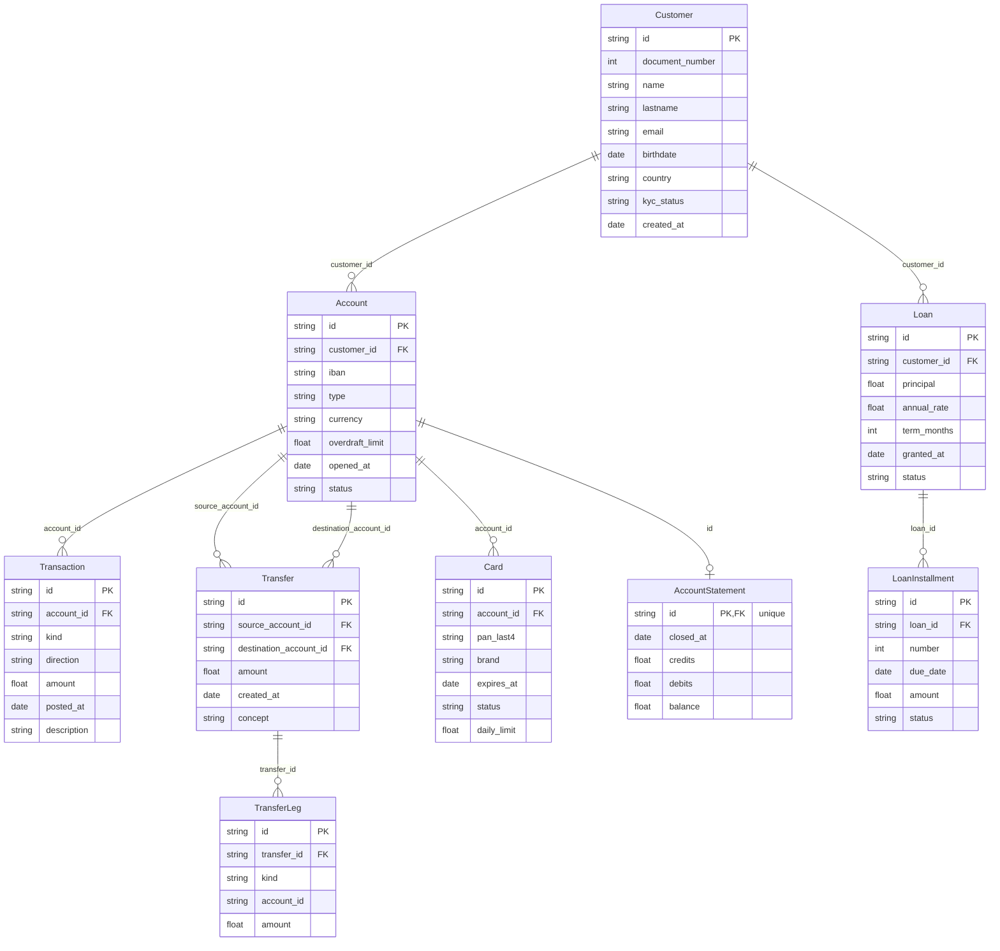

# Banking case — schema

Generated from the schema definitions and the last generated dataset — see `test/example-case/README.md` for how to regenerate it. Do not edit by hand.

## Diagram

## Entities

### Customer

| Field | Type | Null | Key | Origin | Rules |
|---|---|---|---|---|---|
| `id` | string | no | PK | `chaca.key` | — |
| `document_number` | int | no | — | `chaca.sequence` | R11 |
| `name` | string | no | — | custom function | — |
| `lastname` | string | no | — | custom function | — |
| `email` | string | no | — | custom function | — |
| `birthdate` | date | no | — | custom function | — |
| `country` | string | no | — | custom function | — |
| `kyc_status` | string | no | — | `chaca.probability` | R12 |
| `created_at` | date | no | — | custom function | R14 |

### Account

| Field | Type | Null | Key | Origin | Rules |
|---|---|---|---|---|---|
| `id` | string | no | PK | `chaca.key` | R13 |
| `customer_id` | string | no | FK → Customer.id | `chaca.ref` | R14 |
| `iban` | string | no | — | custom function | R11 |
| `type` | string | no | — | `chaca.enum` | R9 |
| `currency` | string | no | — | `chaca.enum` | R4 |
| `overdraft_limit` | float | no | — | custom function | R5 |
| `opened_at` | date | no | — | custom function | R10, R14 |
| `status` | string | no | — | `chaca.probability` | — |

### Transaction

| Field | Type | Null | Key | Origin | Rules |
|---|---|---|---|---|---|
| `id` | string | no | PK | `chaca.key` | — |
| `account_id` | string | no | FK → Account.id | `chaca.ref` | R10 |
| `kind` | string | no | — | custom function | — |
| `direction` | string | no | — | custom function | — |
| `amount` | float | no | — | custom function | — |
| `posted_at` | date | no | — | custom function | R10 |
| `description` | string | no | — | custom function | — |

### Transfer

| Field | Type | Null | Key | Origin | Rules |
|---|---|---|---|---|---|
| `id` | string | no | PK | `chaca.key` | — |
| `source_account_id` | string | no | FK → Account.id | `chaca.ref` | R4, R10 |
| `destination_account_id` | string | no | FK → Account.id | `chaca.ref` | R4, R10 |
| `amount` | float | no | — | custom function | R3 |
| `created_at` | date | no | — | custom function | R10 |
| `concept` | string | no | — | custom function | — |

### TransferLeg

| Field | Type | Null | Key | Origin | Rules |
|---|---|---|---|---|---|
| `id` | string | no | PK | `chaca.key` | — |
| `transfer_id` | string | no | FK → Transfer.id | `chaca.ref` | R3 |
| `kind` | string | no | — | custom function | R2, R3 |
| `account_id` | string | no | — | custom function | — |
| `amount` | float | no | — | custom function | R2, R3 |

### Card

| Field | Type | Null | Key | Origin | Rules |
|---|---|---|---|---|---|
| `id` | string | no | PK | `chaca.key` | — |
| `account_id` | string | no | FK → Account.id | `chaca.ref` | R9 |
| `pan_last4` | string | no | — | custom function | — |
| `brand` | string | no | — | `chaca.probability` | — |
| `expires_at` | date | no | — | custom function | — |
| `status` | string | no | — | `chaca.probability` | — |
| `daily_limit` | float | no | — | custom function | — |

### Loan

| Field | Type | Null | Key | Origin | Rules |
|---|---|---|---|---|---|
| `id` | string | no | PK | `chaca.key` | — |
| `customer_id` | string | no | FK → Customer.id | `chaca.ref` | R12 |
| `principal` | float | no | — | custom function | R6 |
| `annual_rate` | float | no | — | custom function | R6 |
| `term_months` | int | no | — | custom function | R6, R8 |
| `granted_at` | date | no | — | custom function | R7 |
| `status` | string | no | — | `chaca.probability` | — |

### LoanInstallment

| Field | Type | Null | Key | Origin | Rules |
|---|---|---|---|---|---|
| `id` | string | no | PK | `chaca.key` | — |
| `loan_id` | string | no | FK → Loan.id | `chaca.ref` | R6, R7, R8 |
| `number` | int | no | — | custom function | R7, R8 |
| `due_date` | date | no | — | custom function | R7 |
| `amount` | float | no | — | custom function | R6 |
| `status` | string | no | — | `chaca.probability` | — |

### AccountStatement

| Field | Type | Null | Key | Origin | Rules |
|---|---|---|---|---|---|
| `id` | string | no | PK, FK → Account.id | `chaca.key` | R13 |
| `closed_at` | date | no | — | custom function | — |
| `credits` | float | no | — | custom function | R1 |
| `debits` | float | no | — | custom function | R1 |
| `balance` | float | no | — | custom function | R1, R5 |

## Rules

| Id | Rule | Fields |
|---|---|---|
| R1 | An account statement's balance equals its credits minus its debits exactly | `AccountStatement.balance`, `AccountStatement.credits`, `AccountStatement.debits` |
| R2 | The global sum of TransferLeg debits equals the global sum of TransferLeg credits | `TransferLeg.kind`, `TransferLeg.amount` |
| R3 | Every transfer has exactly one debit leg and one credit leg, each for its amount | `TransferLeg.transfer_id`, `TransferLeg.kind`, `TransferLeg.amount`, `Transfer.amount` |
| R4 | A transfer's source and destination accounts differ and share the same currency | `Transfer.source_account_id`, `Transfer.destination_account_id`, `Account.currency` |
| R5 | No account's balance falls below its (negative) overdraft_limit | `AccountStatement.balance`, `Account.overdraft_limit` |
| R6 | A loan's installments sum exactly to its principal plus interest | `LoanInstallment.loan_id`, `LoanInstallment.amount`, `Loan.principal`, `Loan.annual_rate`, `Loan.term_months` |
| R7 | A loan's installment due_dates are monthly and consecutive | `LoanInstallment.loan_id`, `LoanInstallment.number`, `LoanInstallment.due_date`, `Loan.granted_at` |
| R8 | A loan's installment numbers run from 1 to term_months without gaps or repeats | `LoanInstallment.loan_id`, `LoanInstallment.number`, `Loan.term_months` |
| R9 | No card belongs to a savings account | `Card.account_id`, `Account.type` |
| R10 | Every transaction and transfer happens on or after its account's opening | `Transaction.posted_at`, `Transaction.account_id`, `Transfer.created_at`, `Transfer.source_account_id`, `Transfer.destination_account_id`, `Account.opened_at` |
| R11 | Every customer's document_number and every account's iban are unique | `Customer.document_number`, `Account.iban` |
| R12 | Only customers with a verified kyc_status have loans | `Loan.customer_id`, `Customer.kyc_status` |
| R13 | Every account has exactly one statement | `AccountStatement.id`, `Account.id` |
| R14 | Every account opens on or after its customer's created_at | `Customer.created_at`, `Account.customer_id`, `Account.opened_at` |
