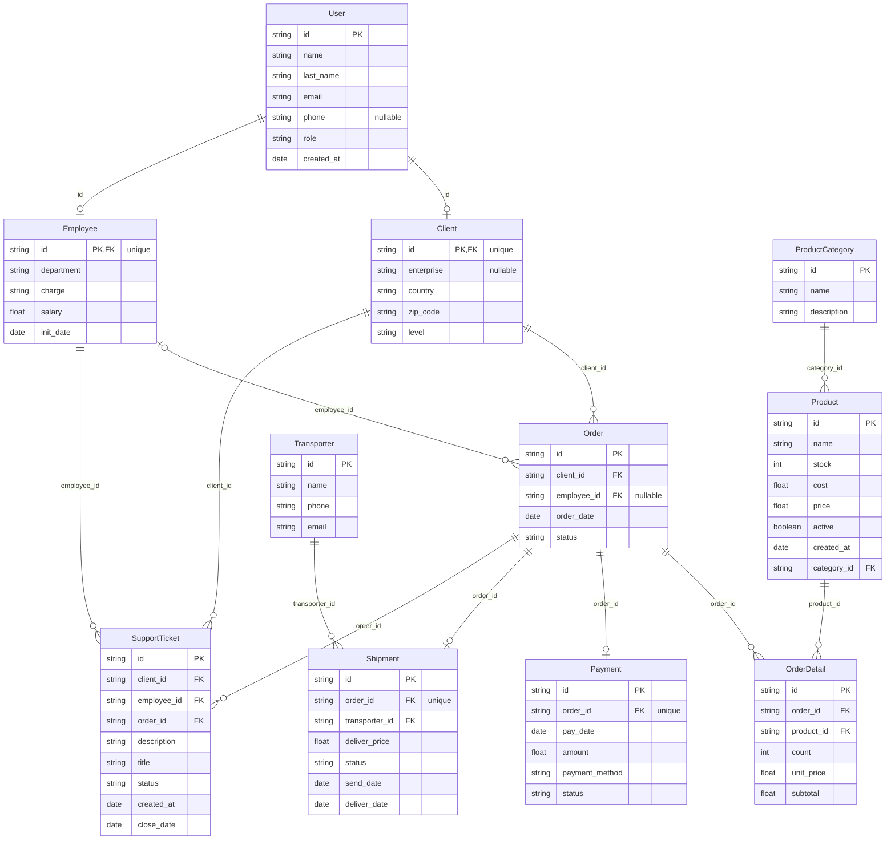

# Ecommerce case — schema

Generated from the schema definitions and the last generated dataset — see `test/example-case/README.md` for how to regenerate it. Do not edit by hand.

## Diagram

## Entities

### Client

| Field | Type | Null | Key | Origin | Rules |
|---|---|---|---|---|---|
| `id` | string | no | PK, FK → User.id | `chaca.key` | R1, R2 |
| `enterprise` | string | sometimes | — | custom function | — |
| `country` | string | no | — | custom function | — |
| `zip_code` | string | no | — | custom function | — |
| `level` | string | no | — | `chaca.probability` | R3 |

### Employee

| Field | Type | Null | Key | Origin | Rules |
|---|---|---|---|---|---|
| `id` | string | no | PK, FK → User.id | `chaca.key` | R4, R5 |
| `department` | string | no | — | `chaca.enum` | — |
| `charge` | string | no | — | custom function | — |
| `salary` | float | no | — | custom function | — |
| `init_date` | date | no | — | custom function | — |

### OrderDetail

| Field | Type | Null | Key | Origin | Rules |
|---|---|---|---|---|---|
| `id` | string | no | PK | `chaca.key` | — |
| `order_id` | string | no | FK → Order.id | `chaca.ref` | R7, R11 |
| `product_id` | string | no | FK → Product.id | `chaca.ref` | R7, R9, R11 |
| `count` | int | no | — | custom function | R8, R10 |
| `unit_price` | float | no | — | custom function | R9, R10 |
| `subtotal` | float | no | — | custom function | R10, R13 |

### Order

| Field | Type | Null | Key | Origin | Rules |
|---|---|---|---|---|---|
| `id` | string | no | PK | `chaca.key` | — |
| `client_id` | string | no | FK → Client.id | `chaca.ref` | — |
| `employee_id` | string | sometimes | FK → Employee.id | `chaca.ref` | — |
| `order_date` | date | no | — | custom function | R11, R14, R17, R19 |
| `status` | string | no | — | `chaca.enum` | R12, R16, R23, R24 |

### Payment

| Field | Type | Null | Key | Origin | Rules |
|---|---|---|---|---|---|
| `id` | string | no | PK | `chaca.key` | — |
| `order_id` | string | no | FK → Order.id | `chaca.ref` | R12, R13, R14, R24 |
| `pay_date` | date | no | — | custom function | R14 |
| `amount` | float | no | — | custom function | R13 |
| `payment_method` | string | no | — | `chaca.enum` | — |
| `status` | string | no | — | custom function | R12 |

### ProductCategory

| Field | Type | Null | Key | Origin | Rules |
|---|---|---|---|---|---|
| `id` | string | no | PK | `chaca.key` | — |
| `name` | string | no | — | custom function | R21 |
| `description` | string | no | — | custom function | — |

### Product

| Field | Type | Null | Key | Origin | Rules |
|---|---|---|---|---|---|
| `id` | string | no | PK | `chaca.key` | — |
| `name` | string | no | — | custom function | — |
| `stock` | int | no | — | custom function | — |
| `cost` | float | no | — | custom function | R6 |
| `price` | float | no | — | custom function | R6, R9 |
| `active` | boolean | no | — | custom function | — |
| `created_at` | date | no | — | custom function | R11 |
| `category_id` | string | no | FK → ProductCategory.id | `chaca.ref` | — |

### Shipment

| Field | Type | Null | Key | Origin | Rules |
|---|---|---|---|---|---|
| `id` | string | no | PK | `chaca.key` | — |
| `order_id` | string | no | FK → Order.id | `chaca.ref` | R15, R16, R17, R23 |
| `transporter_id` | string | no | FK → Transporter.id | `chaca.ref` | — |
| `deliver_price` | float | no | — | custom function | — |
| `status` | string | no | — | custom function | R16, R17, R18 |
| `send_date` | date | no | — | custom function | R17, R18 |
| `deliver_date` | date | no | — | custom function | R18 |

### SupportTicket

| Field | Type | Null | Key | Origin | Rules |
|---|---|---|---|---|---|
| `id` | string | no | PK | `chaca.key` | — |
| `client_id` | string | no | FK → Client.id | `chaca.ref` | — |
| `employee_id` | string | no | FK → Employee.id | `chaca.ref` | — |
| `order_id` | string | no | FK → Order.id | `chaca.ref` | R19 |
| `description` | string | no | — | custom function | — |
| `title` | string | no | — | custom function | — |
| `status` | string | no | — | `chaca.enum` | R20 |
| `created_at` | date | no | — | custom function | R19, R20 |
| `close_date` | date | no | — | custom function | R20 |

### Transporter

| Field | Type | Null | Key | Origin | Rules |
|---|---|---|---|---|---|
| `id` | string | no | PK | `chaca.key` | — |
| `name` | string | no | — | custom function | — |
| `phone` | string | no | — | custom function | — |
| `email` | string | no | — | custom function | R22 |

### User

| Field | Type | Null | Key | Origin | Rules |
|---|---|---|---|---|---|
| `id` | string | no | PK | `chaca.key` | R2, R5 |
| `name` | string | no | — | custom function | — |
| `last_name` | string | no | — | custom function | — |
| `email` | string | no | — | custom function | — |
| `phone` | string | sometimes | — | custom function | — |
| `role` | string | no | — | `chaca.probability` | R1, R2, R4, R5 |
| `created_at` | date | no | — | custom function | — |

## Rules

| Id | Rule | Fields |
|---|---|---|
| R1 | The number of clients equals the number of users with role 'client' | `Client.id`, `User.role` |
| R2 | Every client's id maps back to a user with role 'client' | `Client.id`, `User.id`, `User.role` |
| R3 | There are more 'normal' clients than 'premium' or 'vip' ones | `Client.level` |
| R4 | The number of employees equals the number of users with role 'employee' | `Employee.id`, `User.role` |
| R5 | Every employee's id maps back to a user with role 'employee' | `Employee.id`, `User.id`, `User.role` |
| R6 | A product's price is always greater than or equal to its cost | `Product.price`, `Product.cost` |
| R7 | A product cannot be repeated within the same order | `OrderDetail.order_id`, `OrderDetail.product_id` |
| R8 | An order detail's count is between 1 and 10 | `OrderDetail.count` |
| R9 | An order detail's unit_price equals the referenced product's price | `OrderDetail.unit_price`, `OrderDetail.product_id`, `Product.price` |
| R10 | An order detail's subtotal equals count times unit_price | `OrderDetail.subtotal`, `OrderDetail.count`, `OrderDetail.unit_price` |
| R11 | An order detail's referenced product was created before the order's date | `OrderDetail.order_id`, `OrderDetail.product_id`, `Order.order_date`, `Product.created_at` |
| R12 | A delivered order's payment status is always 'completed' | `Payment.order_id`, `Payment.status`, `Order.status` |
| R13 | A payment's amount equals the sum of its order's order detail subtotals | `Payment.amount`, `Payment.order_id`, `OrderDetail.subtotal` |
| R14 | A payment's pay_date is on or after its order's order_date | `Payment.pay_date`, `Payment.order_id`, `Order.order_date` |
| R15 | An order has at most one shipment | `Shipment.order_id` |
| R16 | A delivered order's shipment status is always 'delivered' | `Shipment.order_id`, `Shipment.status`, `Order.status` |
| R17 | A shipment's send_date exists only once it left the warehouse, and is after the order's date | `Shipment.send_date`, `Shipment.status`, `Shipment.order_id`, `Order.order_date` |
| R18 | A shipment's deliver_date exists only for 'delivered' or 'returned' shipments, and is after send_date | `Shipment.deliver_date`, `Shipment.status`, `Shipment.send_date` |
| R19 | A support ticket's created_at is on or after its order's order_date | `SupportTicket.created_at`, `SupportTicket.order_id`, `Order.order_date` |
| R20 | A support ticket's close_date exists only when closed, and is after created_at | `SupportTicket.close_date`, `SupportTicket.status`, `SupportTicket.created_at` |
| R21 | A product category's name is never empty | `ProductCategory.name` |
| R22 | A transporter's email has the shape of an email address | `Transporter.email` |
| R23 | Only send/delivered orders have a shipment | `Shipment.order_id`, `Order.status` |
| R24 | Every non-canceled order has exactly one payment, canceled orders have none, and delivered orders are always paid | `Payment.order_id`, `Order.status` |
