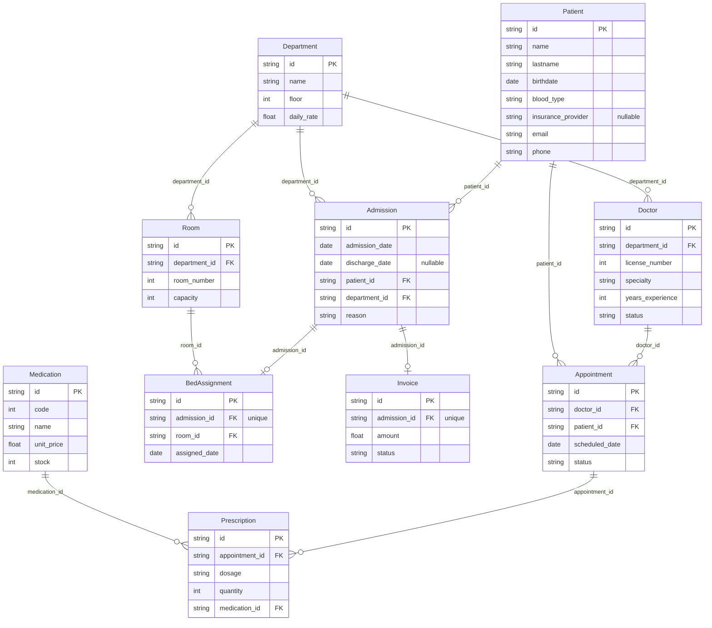

# Hospital case — schema

Generated from the schema definitions and the last generated dataset — see `test/example-case/README.md` for how to regenerate it. Do not edit by hand.

## Diagram

## Entities

### Admission

| Field | Type | Null | Key | Origin | Rules |
|---|---|---|---|---|---|
| `id` | string | no | PK | `chaca.key` | — |
| `admission_date` | date | no | — | custom function | R4, R8, R16, R24 |
| `discharge_date` | date | sometimes | — | custom function | R3, R4, R5, R7, R14, R16, R24 |
| `patient_id` | string | no | FK → Patient.id | `chaca.ref` | R3, R24 |
| `department_id` | string | no | FK → Department.id | `chaca.ref` | R23 |
| `reason` | string | no | — | custom function | — |

### Appointment

| Field | Type | Null | Key | Origin | Rules |
|---|---|---|---|---|---|
| `id` | string | no | PK | `chaca.key` | — |
| `doctor_id` | string | no | FK → Doctor.id | `chaca.ref` | R9 |
| `patient_id` | string | no | FK → Patient.id | `chaca.ref` | — |
| `scheduled_date` | date | no | — | custom function | R10 |
| `status` | string | no | — | custom function | R10, R11 |

### BedAssignment

| Field | Type | Null | Key | Origin | Rules |
|---|---|---|---|---|---|
| `id` | string | no | PK | `chaca.key` | — |
| `admission_id` | string | no | FK → Admission.id | `chaca.ref` | R6, R23 |
| `room_id` | string | no | FK → Room.id | `chaca.ref` | R7, R23 |
| `assigned_date` | date | no | — | custom function | R8 |

### Department

| Field | Type | Null | Key | Origin | Rules |
|---|---|---|---|---|---|
| `id` | string | no | PK | `chaca.key` | — |
| `name` | string | no | — | `chaca.sequential` | R22 |
| `floor` | int | no | — | custom function | — |
| `daily_rate` | float | no | — | custom function | R16 |

### Doctor

| Field | Type | Null | Key | Origin | Rules |
|---|---|---|---|---|---|
| `id` | string | no | PK | `chaca.key` | — |
| `department_id` | string | no | FK → Department.id | `chaca.ref` | — |
| `license_number` | int | no | — | `chaca.sequence` | R2 |
| `specialty` | string | no | — | `chaca.enum` | — |
| `years_experience` | int | no | — | custom function | R1 |
| `status` | string | no | — | `chaca.enum` | R9 |

### Invoice

| Field | Type | Null | Key | Origin | Rules |
|---|---|---|---|---|---|
| `id` | string | no | PK | `chaca.key` | — |
| `admission_id` | string | no | FK → Admission.id | `chaca.ref` | R14, R15 |
| `amount` | float | no | — | custom function | R16 |
| `status` | string | no | — | `chaca.enum` | — |

### Medication

| Field | Type | Null | Key | Origin | Rules |
|---|---|---|---|---|---|
| `id` | string | no | PK | `chaca.key` | — |
| `code` | int | no | — | `chaca.sequence` | R21 |
| `name` | string | no | — | custom function | — |
| `unit_price` | float | no | — | custom function | R20 |
| `stock` | int | no | — | custom function | R12, R20, R25 |

### Patient

| Field | Type | Null | Key | Origin | Rules |
|---|---|---|---|---|---|
| `id` | string | no | PK | `chaca.key` | — |
| `name` | string | no | — | custom function | — |
| `lastname` | string | no | — | custom function | — |
| `birthdate` | date | no | — | custom function | R18 |
| `blood_type` | string | no | — | `chaca.enum` | — |
| `insurance_provider` | string | sometimes | — | custom function | R19 |
| `email` | string | no | — | custom function | — |
| `phone` | string | no | — | custom function | — |

### Prescription

| Field | Type | Null | Key | Origin | Rules |
|---|---|---|---|---|---|
| `id` | string | no | PK | `chaca.key` | — |
| `appointment_id` | string | no | FK → Appointment.id | `chaca.ref` | R11 |
| `dosage` | string | no | — | custom function | — |
| `quantity` | int | no | — | custom function | R13, R25 |
| `medication_id` | string | no | FK → Medication.id | `chaca.ref` | R12, R25 |

### Room

| Field | Type | Null | Key | Origin | Rules |
|---|---|---|---|---|---|
| `id` | string | no | PK | `chaca.key` | — |
| `department_id` | string | no | FK → Department.id | `chaca.ref` | R23 |
| `room_number` | int | no | — | `chaca.sequence` | — |
| `capacity` | int | no | — | custom function | R7, R17 |

## Rules

| Id | Rule | Fields |
|---|---|---|
| R1 | A doctor's years_experience is between 0 and 40 | `Doctor.years_experience` |
| R2 | A doctor's license_number is unique and sequential starting at 10000 | `Doctor.license_number` |
| R3 | A patient cannot have more than one simultaneous active admission | `Admission.patient_id`, `Admission.discharge_date` |
| R4 | An admission's discharge_date, when present, is after admission_date | `Admission.discharge_date`, `Admission.admission_date` |
| R5 | Some admissions are still active and some are discharged | `Admission.discharge_date` |
| R6 | Every admission has exactly one bed assignment | `BedAssignment.admission_id` |
| R7 | A room's active bed assignments never exceed its capacity | `BedAssignment.room_id`, `Room.capacity`, `Admission.discharge_date` |
| R8 | A bed assignment's assigned_date matches its admission's admission_date | `BedAssignment.assigned_date`, `Admission.admission_date` |
| R9 | Only active doctors can have appointments assigned to them | `Appointment.doctor_id`, `Doctor.status` |
| R10 | Appointments scheduled in the future can only be 'scheduled' or 'cancelled' | `Appointment.scheduled_date`, `Appointment.status` |
| R11 | Prescriptions can only reference completed appointments | `Prescription.appointment_id`, `Appointment.status` |
| R12 | Prescriptions only reference medications that had stock | `Prescription.medication_id`, `Medication.stock` |
| R13 | A prescription's quantity is between 1 and 30 | `Prescription.quantity` |
| R14 | Invoices can only reference discharged admissions | `Invoice.admission_id`, `Admission.discharge_date` |
| R15 | An admission can have at most one invoice | `Invoice.admission_id` |
| R16 | An invoice's amount equals the nights of stay times the department's daily_rate | `Invoice.amount`, `Admission.discharge_date`, `Admission.admission_date`, `Department.daily_rate` |
| R17 | A room's capacity is between 1 and 4 beds | `Room.capacity` |
| R18 | Every patient is between 0 and 100 years old | `Patient.birthdate` |
| R19 | Some patients are uninsured | `Patient.insurance_provider` |
| R20 | A medication's unit_price and stock are non-negative | `Medication.unit_price`, `Medication.stock` |
| R21 | A medication's code is unique and sequential starting at 1000 | `Medication.code` |
| R22 | There are exactly 8 departments, each with a distinct name | `Department.name` |
| R23 | A bed assignment's room belongs to its admission's department | `BedAssignment.room_id`, `BedAssignment.admission_id`, `Room.department_id`, `Admission.department_id` |
| R24 | No patient has two admissions with overlapping date ranges | `Admission.patient_id`, `Admission.admission_date`, `Admission.discharge_date` |
| R25 | The sum of a medication's prescribed quantities never exceeds its stock | `Prescription.medication_id`, `Prescription.quantity`, `Medication.stock` |
