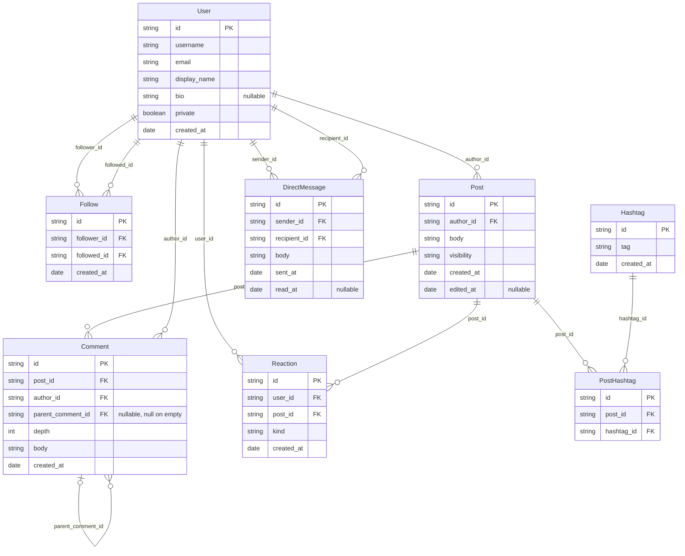

# Social case — schema

Generated from the schema definitions and the last generated dataset — see `test/example-case/README.md` for how to regenerate it. Do not edit by hand.

## Diagram

## Entities

### User

| Field | Type | Null | Key | Origin | Rules |
|---|---|---|---|---|---|
| `id` | string | no | PK | `chaca.key` | — |
| `username` | string | no | — | custom function | R11 |
| `email` | string | no | — | custom function | — |
| `display_name` | string | no | — | custom function | — |
| `bio` | string | sometimes | — | custom function | — |
| `private` | boolean | no | — | `chaca.probability` | — |
| `created_at` | date | no | — | custom function | R12 |

### Follow

| Field | Type | Null | Key | Origin | Rules |
|---|---|---|---|---|---|
| `id` | string | no | PK | `chaca.key` | — |
| `follower_id` | string | no | FK → User.id | `chaca.ref` | R1, R2 |
| `followed_id` | string | no | FK → User.id | `chaca.ref` | R1, R2 |
| `created_at` | date | no | — | custom function | — |

### Post

| Field | Type | Null | Key | Origin | Rules |
|---|---|---|---|---|---|
| `id` | string | no | PK | `chaca.key` | — |
| `author_id` | string | no | FK → User.id | `chaca.ref` | R12 |
| `body` | string | no | — | custom function | — |
| `visibility` | string | no | — | `chaca.probability` | — |
| `created_at` | date | no | — | custom function | R12, R13 |
| `edited_at` | date | sometimes | — | custom function | R13 |

### Comment

| Field | Type | Null | Key | Origin | Rules |
|---|---|---|---|---|---|
| `id` | string | no | PK | `chaca.key` | — |
| `post_id` | string | no | FK → Post.id | `chaca.ref` | R3, R12 |
| `author_id` | string | no | FK → User.id | `chaca.ref` | — |
| `parent_comment_id` | string | sometimes | FK → Comment.id | `chaca.ref` | R3, R4, R6 |
| `depth` | int | no | — | custom function | R4, R5 |
| `body` | string | no | — | custom function | — |
| `created_at` | date | no | — | custom function | R12 |

### Reaction

| Field | Type | Null | Key | Origin | Rules |
|---|---|---|---|---|---|
| `id` | string | no | PK | `chaca.key` | — |
| `user_id` | string | no | FK → User.id | `chaca.ref` | R7 |
| `post_id` | string | no | FK → Post.id | `chaca.ref` | R7, R12 |
| `kind` | string | no | — | `chaca.probability` | — |
| `created_at` | date | no | — | custom function | R12 |

### Hashtag

| Field | Type | Null | Key | Origin | Rules |
|---|---|---|---|---|---|
| `id` | string | no | PK | `chaca.key` | — |
| `tag` | string | no | — | `chaca.sequential` | R11 |
| `created_at` | date | no | — | custom function | — |

### PostHashtag

| Field | Type | Null | Key | Origin | Rules |
|---|---|---|---|---|---|
| `id` | string | no | PK | `chaca.key` | — |
| `post_id` | string | no | FK → Post.id | `chaca.ref` | R8 |
| `hashtag_id` | string | no | FK → Hashtag.id | `chaca.ref` | R8 |

### DirectMessage

| Field | Type | Null | Key | Origin | Rules |
|---|---|---|---|---|---|
| `id` | string | no | PK | `chaca.key` | — |
| `sender_id` | string | no | FK → User.id | `chaca.ref` | R9 |
| `recipient_id` | string | no | FK → User.id | `chaca.ref` | R9 |
| `body` | string | no | — | custom function | — |
| `sent_at` | date | no | — | custom function | R10 |
| `read_at` | date | sometimes | — | custom function | R10 |

## Rules

| Id | Rule | Fields |
|---|---|---|
| R1 | No one follows themselves | `Follow.follower_id`, `Follow.followed_id` |
| R2 | The (follower, followed) pair never repeats | `Follow.follower_id`, `Follow.followed_id` |
| R3 | A comment's parent, when present, belongs to the same post | `Comment.parent_comment_id`, `Comment.post_id` |
| R4 | A comment's depth matches the real depth of its parent chain | `Comment.depth`, `Comment.parent_comment_id` |
| R5 | No comment's depth exceeds 2 (a 3-level tree) | `Comment.depth` |
| R6 | The comment tree has no cycles | `Comment.parent_comment_id` |
| R7 | A user reacts to a post at most once | `Reaction.user_id`, `Reaction.post_id` |
| R8 | A post has at most 5 hashtags, none repeated | `PostHashtag.post_id`, `PostHashtag.hashtag_id` |
| R9 | No direct message is sent to oneself | `DirectMessage.sender_id`, `DirectMessage.recipient_id` |
| R10 | A direct message's read_at, when present, is after sent_at | `DirectMessage.read_at`, `DirectMessage.sent_at` |
| R11 | Every user's username and every hashtag's tag are unique | `User.username`, `Hashtag.tag` |
| R12 | The date chain user -> post -> comment -> reaction is non-decreasing | `User.created_at`, `Post.author_id`, `Post.created_at`, `Comment.post_id`, `Comment.created_at`, `Reaction.post_id`, `Reaction.created_at` |
| R13 | A post's edited_at, when present, is after created_at | `Post.edited_at`, `Post.created_at` |
