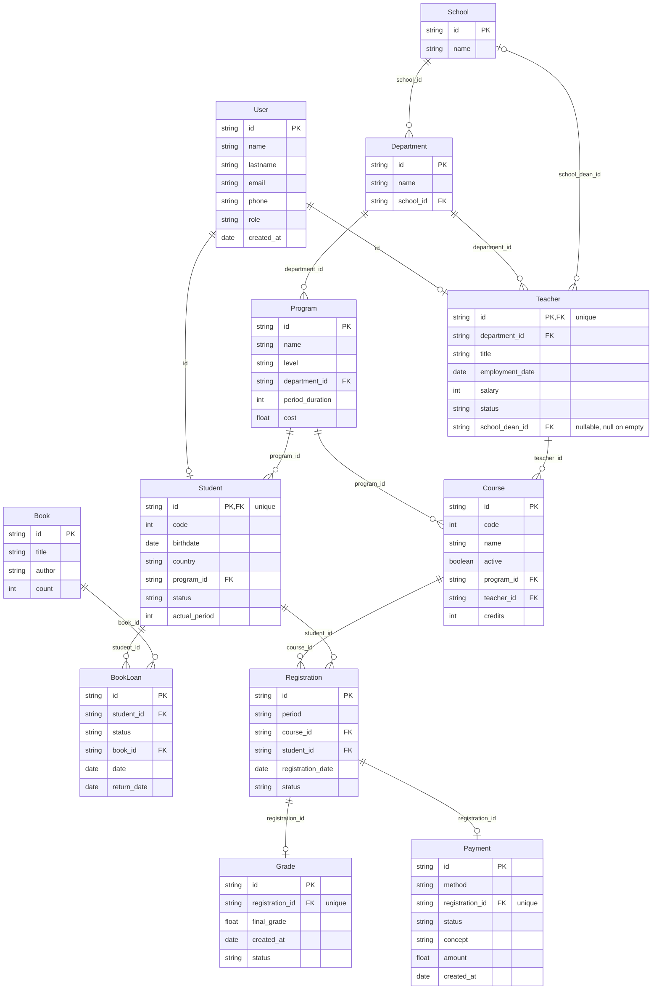

# University case — schema

Generated from the schema definitions and the last generated dataset — see `test/example-case/README.md` for how to regenerate it. Do not edit by hand.

## Diagram

## Entities

### BookLoan

| Field | Type | Null | Key | Origin | Rules |
|---|---|---|---|---|---|
| `id` | string | no | PK | `chaca.key` | — |
| `student_id` | string | no | FK → Student.id | `chaca.ref` | R14 |
| `status` | string | no | — | `chaca.enum` | R13, R14, R15 |
| `book_id` | string | no | FK → Book.id | `chaca.ref` | R13 |
| `date` | date | no | — | custom function | R15 |
| `return_date` | date | no | — | custom function | R15 |

### Book

| Field | Type | Null | Key | Origin | Rules |
|---|---|---|---|---|---|
| `id` | string | no | PK | `chaca.key` | — |
| `title` | string | no | — | custom function | — |
| `author` | string | no | — | custom function | — |
| `count` | int | no | — | custom function | R12, R13 |

### Course

| Field | Type | Null | Key | Origin | Rules |
|---|---|---|---|---|---|
| `id` | string | no | PK | `chaca.key` | — |
| `code` | int | no | — | `chaca.sequence` | R24 |
| `name` | string | no | — | custom function | — |
| `active` | boolean | no | — | custom function | R11 |
| `program_id` | string | no | FK → Program.id | `chaca.ref` | R7 |
| `teacher_id` | string | no | FK → Teacher.id | `chaca.ref` | R11 |
| `credits` | int | no | — | custom function | R5, R7, R10 |

### Department

| Field | Type | Null | Key | Origin | Rules |
|---|---|---|---|---|---|
| `id` | string | no | PK | `chaca.key` | — |
| `name` | string | no | — | custom function | — |
| `school_id` | string | no | FK → School.id | `chaca.ref` | R23 |

### Grade

| Field | Type | Null | Key | Origin | Rules |
|---|---|---|---|---|---|
| `id` | string | no | PK | `chaca.key` | R29 |
| `registration_id` | string | no | FK → Registration.id | `chaca.ref` | R1, R2, R3, R26, R27 |
| `final_grade` | float | no | — | custom function | R3 |
| `created_at` | date | no | — | custom function | R27 |
| `status` | string | no | — | `chaca.enum` | — |

### Payment

| Field | Type | Null | Key | Origin | Rules |
|---|---|---|---|---|---|
| `id` | string | no | PK | `chaca.key` | — |
| `method` | string | no | — | `chaca.enum` | — |
| `registration_id` | string | no | FK → Registration.id | `chaca.ref` | R6, R7, R9, R30 |
| `status` | string | no | — | `chaca.enum` | R8, R9 |
| `concept` | string | no | — | `chaca.enum` | R7 |
| `amount` | float | no | — | custom function | R7 |
| `created_at` | date | no | — | custom function | — |

### Program

| Field | Type | Null | Key | Origin | Rules |
|---|---|---|---|---|---|
| `id` | string | no | PK | `chaca.key` | — |
| `name` | string | no | — | custom function | — |
| `level` | string | no | — | `chaca.enum` | — |
| `department_id` | string | no | FK → Department.id | `chaca.ref` | — |
| `period_duration` | int | no | — | custom function | R18, R20 |
| `cost` | float | no | — | custom function | R7 |

### Registration

| Field | Type | Null | Key | Origin | Rules |
|---|---|---|---|---|---|
| `id` | string | no | PK | `chaca.key` | R1 |
| `period` | string | no | — | custom function | R4, R5, R28 |
| `course_id` | string | no | FK → Course.id | `chaca.ref` | R4, R5, R7 |
| `student_id` | string | no | FK → Student.id | `chaca.ref` | R4, R5 |
| `registration_date` | date | no | — | custom function | R27, R28 |
| `status` | string | no | — | `chaca.enum` | R3, R6, R26, R29, R30 |

### School

| Field | Type | Null | Key | Origin | Rules |
|---|---|---|---|---|---|
| `id` | string | no | PK | `chaca.key` | R23 |
| `name` | string | no | — | custom function | R22 |

### Student

| Field | Type | Null | Key | Origin | Rules |
|---|---|---|---|---|---|
| `id` | string | no | PK, FK → User.id | `chaca.key` | R19 |
| `code` | int | no | — | `chaca.sequence` | R25 |
| `birthdate` | date | no | — | custom function | R21 |
| `country` | string | no | — | custom function | — |
| `program_id` | string | no | FK → Program.id | `chaca.ref` | R20 |
| `status` | string | no | — | `chaca.enum` | — |
| `actual_period` | int | no | — | custom function | R20, R32 |

### Teacher

| Field | Type | Null | Key | Origin | Rules |
|---|---|---|---|---|---|
| `id` | string | no | PK, FK → User.id | `chaca.key` | R16 |
| `department_id` | string | no | FK → Department.id | `chaca.ref` | — |
| `title` | string | no | — | `chaca.probability` | — |
| `employment_date` | date | no | — | custom function | — |
| `salary` | int | no | — | custom function | — |
| `status` | string | no | — | `chaca.enum` | R11, R17 |
| `school_dean_id` | string | sometimes | FK → School.id | `chaca.ref` | R17, R31 |

### User

| Field | Type | Null | Key | Origin | Rules |
|---|---|---|---|---|---|
| `id` | string | no | PK | `chaca.key` | — |
| `name` | string | no | — | custom function | — |
| `lastname` | string | no | — | custom function | — |
| `email` | string | no | — | custom function | — |
| `phone` | string | no | — | custom function | — |
| `role` | string | no | — | `chaca.probability` | R16, R19 |
| `created_at` | date | no | — | custom function | — |

## Rules

| Id | Rule | Fields |
|---|---|---|
| R1 | Every grade's registration_id resolves to exactly one registration | `Grade.registration_id`, `Registration.id` |
| R2 | A registration cannot have more than one grade | `Grade.registration_id` |
| R3 | A grade's final_grade range matches its registration's status (approved => 60-100, failed => 0-59) | `Registration.status`, `Grade.registration_id`, `Grade.final_grade` |
| R4 | A student cannot be registered more than once in the same course and period | `Registration.student_id`, `Registration.course_id`, `Registration.period` |
| R5 | A student cannot exceed 20 credits per period | `Registration.student_id`, `Registration.period`, `Registration.course_id`, `Course.credits` |
| R6 | Every payment references an active registration | `Payment.registration_id`, `Registration.status` |
| R7 | A payment's amount matches its concept: program cost, credits x fee, or a fixed fee | `Payment.amount`, `Payment.concept`, `Payment.registration_id`, `Registration.course_id`, `Course.credits`, `Course.program_id`, `Program.cost` |
| R8 | Not every payment is failed | `Payment.status` |
| R9 | A registration can have at most one non-failed payment | `Payment.registration_id`, `Payment.status` |
| R10 | A course's credits are between 1 and 10 | `Course.credits` |
| R11 | An active course can only be taught by an active teacher | `Course.active`, `Course.teacher_id`, `Teacher.status` |
| R12 | A book's count is never negative | `Book.count` |
| R13 | The number of open loans of a book never exceeds its count | `BookLoan.book_id`, `BookLoan.status`, `Book.count` |
| R14 | A student can have at most 5 open book loans | `BookLoan.student_id`, `BookLoan.status` |
| R15 | A returned book loan's return_date is after its date | `BookLoan.status`, `BookLoan.return_date`, `BookLoan.date` |
| R16 | The number of teachers equals the number of users with role 'teacher' | `Teacher.id`, `User.role` |
| R17 | A teacher who is not 'active' never has a school_dean_id | `Teacher.status`, `Teacher.school_dean_id` |
| R18 | A program's period_duration is between 4 and 8 | `Program.period_duration` |
| R19 | The number of students equals the number of users with role 'student' | `Student.id`, `User.role` |
| R20 | A student's actual_period never exceeds their program's period_duration | `Student.actual_period`, `Student.program_id`, `Program.period_duration` |
| R21 | Every student is at least 16 years old | `Student.birthdate` |
| R22 | A school's name is never empty | `School.name` |
| R23 | A department's school_id references an existing school | `Department.school_id`, `School.id` |
| R24 | Every course's code is unique | `Course.code` |
| R25 | Every student's code is unique | `Student.code` |
| R26 | Only 'approved' or 'failed' registrations have a grade | `Grade.registration_id`, `Registration.status` |
| R27 | A grade's created_at is on or after its registration's registration_date | `Grade.created_at`, `Grade.registration_id`, `Registration.registration_date` |
| R28 | A registration's registration_date falls within the half-year named by its period, and is never in the future | `Registration.period`, `Registration.registration_date` |
| R29 | The number of grades equals the number of 'approved' or 'failed' registrations | `Grade.id`, `Registration.status` |
| R30 | Every active registration has exactly one payment, and non-active registrations have none | `Payment.registration_id`, `Registration.status` |
| R31 | A school has at most one dean | `Teacher.school_dean_id` |
| R32 | A student's actual_period is always a defined integer | `Student.actual_period` |
